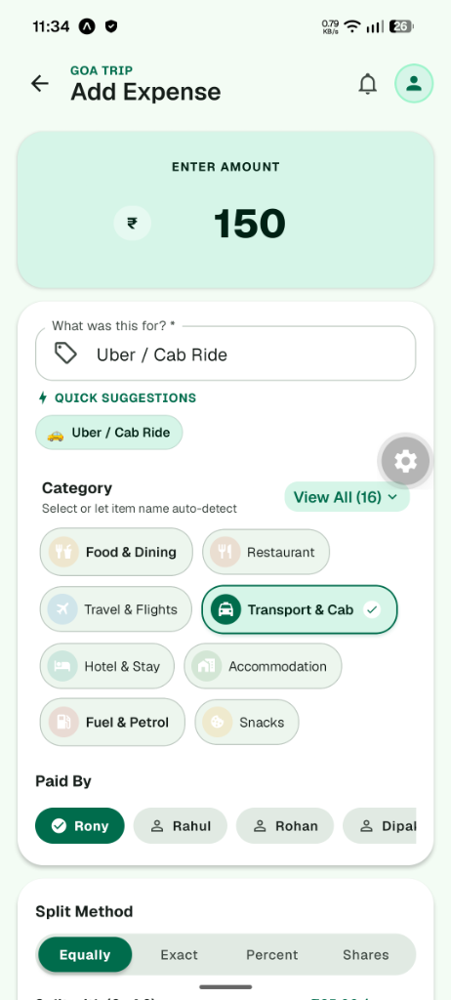
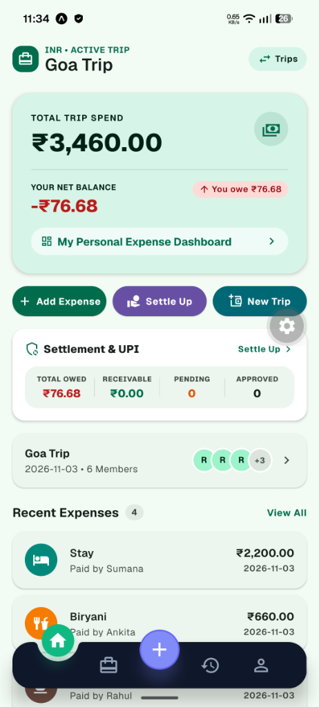
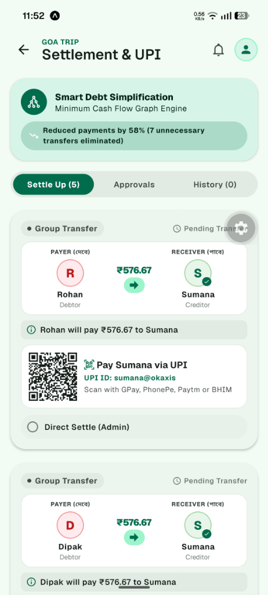
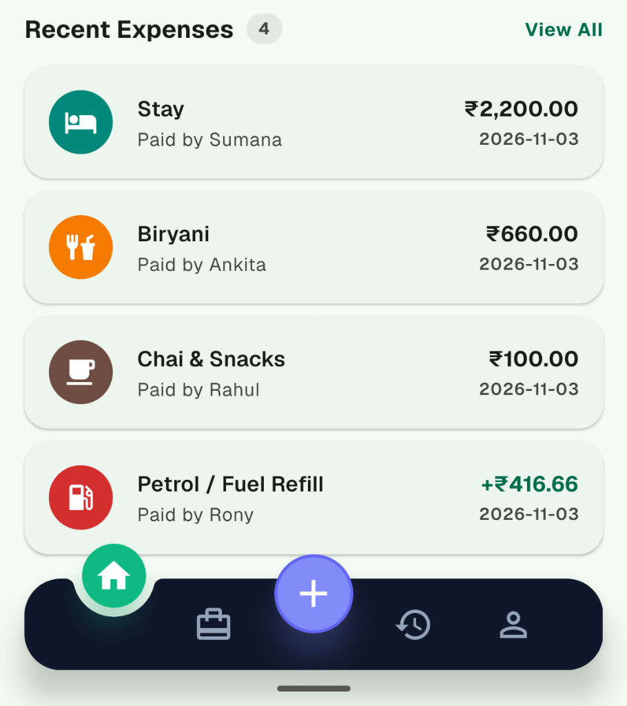

# ✈️ TripSplit — Smart Group Travel & Shared Expense Manager

<p align="center">
  
</p>

<p align="center">
  <b>A modern, offline-first mobile application to track, auto-categorize, split, and settle group travel expenses seamlessly.</b>
</p>

<p align="center">
  
  
  
  
</p>

---

## ✨ Features

- 💡 **Intelligent Auto-Categorization:** Type what you paid for (e.g., *"Dinner"*, *"Uber"*, *"Petrol"*, *"Hotel"*, *"Pizza"*, *"Coffee"*) and TripSplit automatically identifies and selects the category with quick 1-tap template chips.
- ➕ **Elevated Center Action Button:** Clean, modern bottom navigation bar with a center-raised `+` button for rapid transaction recording (inspired by Zomato, Splitwise, and CRED).
- ⚡ **Instant NPCI UPI Settlements:** Built-in deep linking for Google Pay, PhonePe, Paytm, and BHIM with live NPCI QR code scanning and generation.
- 📊 **Greedy Debt Simplification Engine:** Automatically minimizes the number of transactions needed to settle all debts in a group.
- 📱 **Unified Auth Experience:** Seamless side-by-side switch between Log In and Sign Up with a soft travel mesh background.
- 🔔 **Instant In-App Toast Banner:** Color-coded animated notification toasts sliding down from the top on every create, edit, or delete action.
- 🛡️ **Offline-First Cloud Sync:** Full local SQLite/AsyncStorage fallback with continuous Firebase Firestore real-time synchronization.

---

## 📱 Screenshots Showcase

| 💡 **Smart Add Expense** | 🏠 **Modern Dashboard** |
|:---:|:---:|
|  |  |
| *Auto-categorization & flexible splits* | *Real-time balances & transparent cutout navbar* |

| ⚡ **NPCI UPI Settlements** | 📜 **Recent Expenses Feed** |
|:---:|:---:|
|  |  |
| *Greedy algorithm & instant UPI QR payment* | *Interactive transaction cards & custom tab bar* |

---

## 🚀 Getting Started

### Prerequisites

- Node.js (v18+)
- npm or yarn
- Expo Go app on your physical mobile device or an Android/iOS emulator

### Installation

1. **Clone the repository:**
   ```bash
   git clone https://github.com/iamrony27/TripSplit.git
   cd TripSplit
   ```

2. **Install dependencies:**
   ```bash
   npm install
   ```

3. **Configure Environment Variables:**
   Create a `.env` file in the root directory (based on `.env.example`):
   ```env
   EXPO_PUBLIC_FIREBASE_API_KEY=your_api_key
   EXPO_PUBLIC_FIREBASE_AUTH_DOMAIN=your_project.firebaseapp.com
   EXPO_PUBLIC_FIREBASE_PROJECT_ID=your_project_id
   EXPO_PUBLIC_FIREBASE_STORAGE_BUCKET=your_project.appspot.com
   EXPO_PUBLIC_FIREBASE_MESSAGING_SENDER_ID=your_sender_id
   EXPO_PUBLIC_FIREBASE_APP_ID=your_app_id
   ```

4. **Start the development server:**
   ```bash
   npx expo start
   ```

---

## ☕ Support the Developer

> *"Hi! I'm Rony, an independent developer pouring hundreds of late nights and endless passion into building TripSplit completely free, without intrusive ads or paywalls. Every update, algorithm, and feature is hand-crafted to make travel with your friends and loved ones simple and joyful. If TripSplit has helped you split expenses and keep friendships stress-free, a small coffee or tip goes a very long way in keeping this project alive and growing. Your warmth and support mean everything to me! ❤️"*

- **Developer UPI ID:** `rony@okhdfcbank`
- **Supported Apps:** Google Pay, PhonePe, Paytm, BHIM

---

## 🔒 Security & Privacy

TripSplit takes your privacy and credentials seriously:
- **No Private Keys in Repository:** All sensitive tokens, service accounts, and API configurations are strictly isolated in local `.env` files and `.gitignore`.
- **Member-Scoped Rules:** Secure, role-based Firestore security rules protect all trip and expense data.

---

## 📄 License

This project is licensed under the MIT License — see the [LICENSE](LICENSE) file for details.
